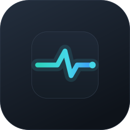

<p align="center">
  
</p>

<h1 align="center">AirPulse</h1>

<p align="center">让键盘灯光告诉你，Codex 正在做什么。</p>

AirPulse 是面向 Windows 的 Codex 状态灯桌面应用。它将多个聊天中仍被跟踪的任务聚合成一个全局状态，通过 USB 控制 NuPhy Air75 V3 的侧灯、主键区或两个区域。你可以自定义状态颜色和亮度，结束接管时恢复原灯效。

应用基于 Tauri 2、Vue 3、TypeScript 和 Rust，采用无边框窗口、Windows 风格窗口控制按钮与 Acrylic 毛玻璃材质。

## 下载与安装

前往 [GitHub Releases](https://github.com/Hegg5577/AirPulse/releases) 下载 Windows x64 安装包：

- `AirPulse_0.1.0_x64-setup.exe`：推荐使用的安装程序。
- `AirPulse_0.1.0_x64_en-US.msi`：MSI 安装包。
- `SHA256SUMS.txt`：安装包的 SHA256 校验值。

安装后打开 AirPulse，通过顶部的 **Codex 联动** 完成插件安装与连接。

## 功能

- **全局状态联动**：聚合多个 Codex 聊天，优先展示失败和权限等待。
- **自定义状态颜色**：取色器与十六进制输入，亮度支持滑条和整数输入。
- **三种展示区域**：侧灯、主键区、侧灯 + 主键区；默认侧灯、30% 亮度。
- **恢复原灯效**：空闲或停止联动时恢复被接管区域，未选择的区域保持原状。
- **Codex 插件一键安装**：随应用携带组件，检测并复用已有安装，收到真实事件后显示就绪。
- **高级手动控制**：独立弹窗中读取灯光参数、设置整区静态 RGB、调节亮度、熄灭或恢复。
- **保留个人配置**：在本地保存颜色、亮度和展示区域。
- **托盘后台运行**：最小化到任务栏，关闭时可选择隐藏到系统托盘或退出程序。

## 全局状态规则

以下规则按从上到下的优先级判断：

| 全局状态 | 默认颜色 | 判定规则 |
| --- | --- | --- |
| 工具失败 | 红色 `#FF3B30` | 任一任务出现可识别的工具失败 |
| 权限等待 | 红色 `#FF3B30` | 没有工具失败，但至少一个任务等待权限 |
| 执行中 | 黄色 `#FFD60A` | 没有异常，且至少一个任务正在执行 |
| 全部完成 | 绿色 `#34C759` | 所有仍被跟踪的任务均已完成 |
| 空闲 | 原灯效 | 没有活跃任务，恢复接管前的灯光配置 |

全部完成后持续显示完成颜色，直到新的任务或生命周期事件改变状态，不会定时熄灭。工具失败只识别工具结果中的明确结构化失败标志，不能覆盖所有工具的错误形式。

## 使用前准备

- Windows 和通过 **USB** 连接的 NuPhy Air75 V3；其他键盘型号及无线连接尚未验证。
- 唤醒键盘，并关闭其他会同时修改键盘灯光的软件。
- 使用支持插件与 Hook 审核的 Codex 版本。应用可检测 PATH 中的原生 `codex.exe`，以及 Windows 桌面版随附的 CLI。

### 连接 Codex

1. 打开 AirPulse，点击顶部的 **Codex 联动**。
2. 点击 **安装 Codex 联动**。已安装时直接复用；未找到 CLI 或安装失败时，弹窗会显示原因。
3. 首次在 Codex 中审核并信任 Hook。CLI 可使用 `/hooks`；如果插件尚未加载，请重新打开 Codex。
4. 在 Codex 中发送一条新消息。弹窗收到真实事件后显示 **联动已就绪**。
5. 回到主页设置颜色、亮度和灯区，再开启联动。

安装插件不会自动开启灯光，也不会代替你确认 Hook 信任。定义变化后，Codex 可能要求重新审核。联动就绪表示最近收到真实事件，并不等同于键盘已连接或全部状态已经实机验证。

### 控制与恢复

开启联动后，灯光配置与手动写灯会被锁定。点击 **停止并恢复** 后再修改配置；如果提示恢复失败，请保持原设备和模式并重试。

标题栏的 **最小化** 按钮将窗口缩小到任务栏；点击 **关闭** 按钮或按 `Alt+F4` 会弹出选择窗口。选择 **隐藏到托盘** 会继续已经开启的联动；选择 **退出 AirPulse** 会结束程序，并尽力恢复原灯效；选择 **取消** 或按 `Esc` 则继续使用当前窗口。单击托盘图标、选择托盘菜单中的 **显示窗口**，或再次启动 AirPulse，都可以打开原窗口。右键托盘图标也可以直接选择 **退出 AirPulse**。

恢复点只保存在当前桌面进程内。正常退出会尽力恢复自动联动的原灯效；强制结束进程或断连退出时不能保证恢复。手动修改请使用手动控制弹窗中的恢复按钮。主键区设置可能短暂经过 100% 亮度，当前不支持逐键独立设色。

## 本地开发

需要 Node.js 22.12 或更高的兼容版本、pnpm、Rust stable、Visual Studio C++ 构建工具及 WebView2。Windows 构建环境可参考 [Tauri 环境准备文档](https://v2.tauri.app/start/prerequisites/)。

在仓库根目录执行：

```powershell
pnpm install --frozen-lockfile
pnpm tauri dev
```

只有桌面应用能访问 HID 后台；单独运行 `pnpm dev` 只能预览页面。

首次从源码开发时，如需使用插件安装功能，先准备当前源码的接收器：

```powershell
cargo build --release --bin keyphore-hook --manifest-path src-tauri/Cargo.toml --locked
powershell -NoProfile -ExecutionPolicy Bypass -File plugin/package.ps1
```

修改 Rust、窗口配置、原生材质或后台命令后，需要重新编译并启动桌面进程；只刷新页面无法更新后台。页面提示后台版本过旧时，也按此方式处理。

## 构建安装包

```powershell
pnpm tauri build
```

构建前脚本会依次构建前端、编译 release Hook 接收器并准备插件文件，再由 Tauri 构建桌面程序与安装包。任一步失败即停止打包。

安装包输出到 `src-tauri/target/release/bundle/`。插件资源随包携带，新安装时复制到当前用户的应用数据目录，不依赖源码位置。仓库不提交 `node_modules`、`dist`、Rust `target` 或插件二进制。

应用图标统一保存在 `src-tauri/icons/`，页面与标题栏图标为 `public/airpulse.png`；桌面图标和 README 使用同一套 AirPulse 资源。

## 项目结构

```text
src/                       Vue 界面与联动配置
public/                    页面静态资源
src-tauri/src/             HID 协议、状态聚合、灯光控制及插件安装
src-tauri/src/bin/         Hook 接收器和硬件诊断程序
src-tauri/tests/           协议、状态、接收器与灯光测试
src-tauri/icons/           应用及安装包图标
plugin/                    Codex 插件清单、Hook 定义与转发脚本
.agents/plugins/           本地插件源清单
scripts/                   发布构建准备脚本
docs/                      集成说明、设计记录与硬件测试记录
```

## 数据与兼容性

Hook 只保存聚合状态所需的标识和阶段，不保存提示词、聊天正文、工具参数或工具结果正文，也不直接访问键盘。

AirPulse 由本项目原来的 Keyphore Windows 开发版本更名而来。为继续使用已有安装和配置，以下内部标识保持兼容：

| 项目 | 兼容标识 |
| --- | --- |
| 应用标识 | `com.barrywu.keyphore.windows` |
| Codex 插件 | `keyphore-windows@keyphore-local` |
| Hook 接收器 | `keyphore-hook.exe` |
| 状态文件 | `%LOCALAPPDATA%\Keyphore\status.json` |
| 页面配置键 | `keyphore.status-light.preferences.v1` |

因此在 Codex 插件列表或本地数据路径中仍可能看到旧名称。已有开发目录安装只复用，不会自动迁移或升级；请保留其插件源目录。更名不代表支持新的键盘型号或 macOS，界面的平台样式也不等同于平台已完成适配。

详细记录见 [Codex 联动说明](docs/codex-status-integration.md) 和 [灯光硬件测试记录](docs/lighting-hardware-tests.md)。`docs/superpowers/` 保留原始设计与实施历史，其中的旧名称和旧计划以当前 README 为准。
